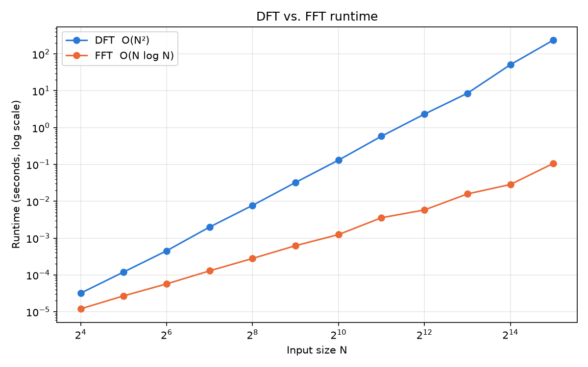
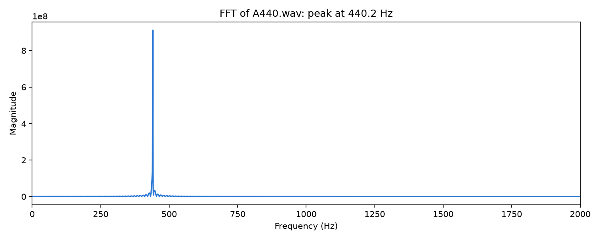

# Fast Fourier Transform Deep Dive

This project implements the discrete Fourier transform (DFT) two ways, directly in O(N²) and with the Cooley–Tukey fast Fourier transform (FFT) in O(N log N). It benchmarks the two against each other and uses the FFT to find the pitch of a recorded tone.

## Files

| File | What it does |
|---|---|
| [dft.py](dft.py) | Direct DFT |
| [fft.py](fft.py) | Recursive radix-2 FFT |
| [test.py](test.py) | Correctness tests, plus a speed comparison of the DFT and the FFT |
| [benchmark.py](benchmark.py) | Plots the timings in [benchmark_results.csv](benchmark_results.csv) to [benchmark.png](benchmark.png) |
| [audio_example.py](audio_example.py) | Runs the FFT on [A440.wav](A440.wav) and plots the spectrum to [a440_spectrum.png](a440_spectrum.png) |

## Running it

Run these from this folder:

```bash
pip install -r requirements.txt
python -m unittest test.TestCorrectness   # correctness tests only
python test.py                            # all tests, including the speed comparison (10+ minutes)
python benchmark.py
python audio_example.py
```

## How the FFT works

The DFT turns N samples x₀, …, x_{N−1} into N frequency coefficients:

$$X_k = \sum_{n=0}^{N-1} x_n \, e^{-2\pi i k n / N}$$

Computing this directly takes N multiply-adds for each of the N coefficients, which is **O(N²)** in total.

The FFT reaches the same result by divide and conquer:

1. **Split** the samples into even-indexed and odd-indexed halves. The DFT then becomes two half-size DFTs, E and O:
   $$X_k = E_k + w^k O_k, \qquad w = e^{-2\pi i / N}$$
2. **Reuse** the work. E and O repeat with period N/2, and w^{k+N/2} = −wᵏ. So a single multiplication gives two outputs:
   $$X_k = E_k + w^k O_k, \qquad X_{k+N/2} = E_k - w^k O_k$$
3. **Recurse** on each half until one sample is left. The DFT of one sample is just that sample.

Each level of recursion does O(N) work, and there are log₂N levels. That gives T(N) = 2T(N/2) + O(N) = **O(N log N)**. For N = 32768, the direct DFT needs about 1.07 billion operations, while the FFT does about 246,000 butterflies. The DFT recomputes the same products over and over; the FFT computes each one once and reuses it.

## Benchmark results



The results match the theory. Up to N = 8192, the DFT's runtime grew about **4×** each time N doubled, which is what O(N²) predicts. The FFT's runtime grew only about **2.2×** per doubling, consistent with O(N log N). The gap therefore keeps widening: the FFT is 2.7× faster at N = 16 and **2,228× faster at N = 32768**, where it takes 0.1 s compared with about 4 minutes for the DFT. That speedup is close to the N / log₂N ≈ 2,185× that theory predicts.

## Audio application: A440.wav

[audio_example.py](audio_example.py) reads the first 65,536 samples of [A440.wav](A440.wav) (1.37 s at 48 kHz) and runs them through the FFT. The spectrum has one sharp peak at **440.2 Hz**, which is the A above middle C used as the standard tuning pitch. That bin is the closest one to 440 Hz, since each bin is 48000 / 65536 ≈ 0.73 Hz wide.



The same idea underlies tuners and pitch detection. In the raw waveform the tone is just a wiggle, but the FFT shows directly which frequencies it contains.

## Real-world uses of the FFT

- **Audio:** tuners, equalizers, noise reduction, song recognition (Shazam), and MP3/AAC compression.
- **Wireless:** Wi-Fi, 4G and 5G send data on many frequencies at once (OFDM), so every phone and router runs FFTs constantly.
- **Imaging:** MRI scanners rebuild images from frequency data with an inverse FFT, and JPEG uses the closely related cosine transform.
- **Fast multiplication:** the FFT multiplies large polynomials and integers in O(N log N) instead of O(N²).
- **Science:** radar, sonar, seismology and vibration analysis.
